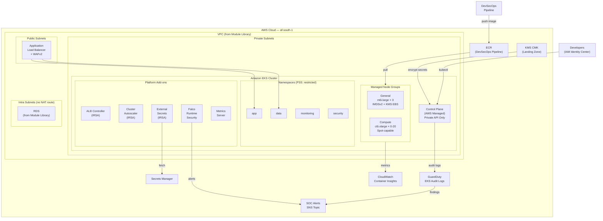
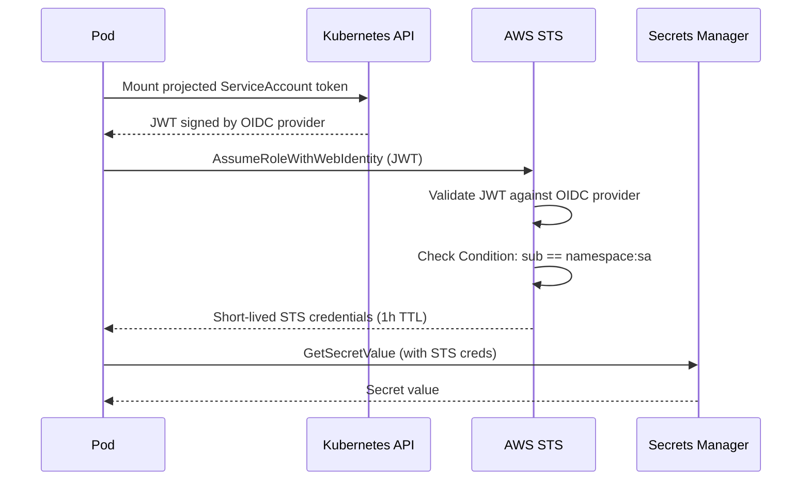
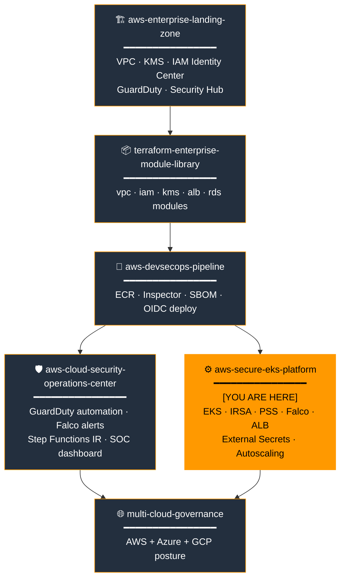
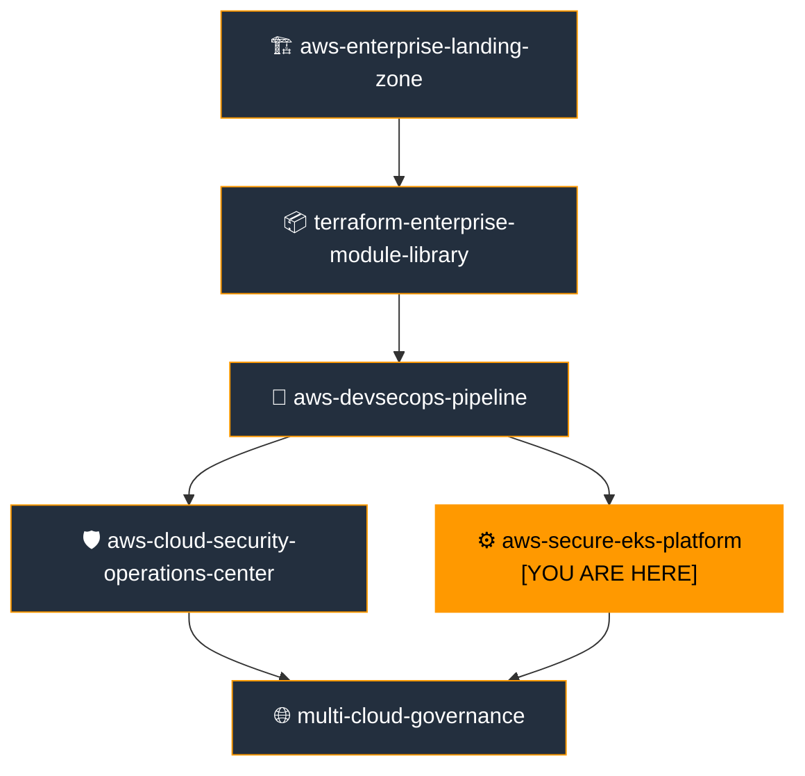

# AWS Secure EKS Platform

[](https://github.com/e-mulenga/aws-secure-eks-platform/actions)
[](https://github.com/e-mulenga/aws-secure-eks-platform/actions)
[](LICENSE)
[](https://www.terraform.io)
[](https://kubernetes.io)
[](https://registry.terraform.io/providers/hashicorp/aws)

> **Portfolio Position 5 of 6** — Enterprise Cloud Platform
> Production-grade, security-hardened Kubernetes platform on AWS EKS with built-in runtime security, IRSA, Pod Security Standards, and SOC integration.

---

## Table of Contents

1. [Executive Summary](#1-executive-summary)
2. [Business Problem](#2-business-problem)
3. [Solution Overview](#3-solution-overview)
4. [Architecture Overview](#4-architecture-overview)
5. [Enterprise Cloud Portfolio Position](#5-enterprise-cloud-portfolio-position)
6. [AWS Services Used](#6-aws-services-used)
7. [Service Selection Rationale](#7-service-selection-rationale)
8. [Terraform Structure](#8-terraform-structure)
9. [Deployment Guide](#9-deployment-guide)
10. [Validation Guide](#10-validation-guide)
11. [Security Controls](#11-security-controls)
12. [Monitoring & Observability](#12-monitoring--observability)
13. [Disaster Recovery Strategy](#13-disaster-recovery-strategy)
14. [Cost Optimization Strategy](#14-cost-optimization-strategy)
15. [Operational Runbooks](#15-operational-runbooks)
16. [AWS Well-Architected Review](#16-aws-well-architected-review)
17. [Skills Demonstrated](#17-skills-demonstrated)
18. [Interview Talking Points](#18-interview-talking-points)
19. [Future Enhancements](#19-future-enhancements)
20. [Related Repositories](#20-related-repositories)

---

## 1. Executive Summary

This repository delivers a **production-grade, security-hardened Amazon EKS platform** built with Terraform, aligned to the AWS Well-Architected Framework, and integrated with the enterprise security posture established by the [AWS Enterprise Landing Zone](https://github.com/e-mulenga/aws-enterprise-landing-zone-terraform) and monitored by the [Cloud Security Operations Centre](https://github.com/e-mulenga/aws-cloud-security-operations-center).

The platform enforces a defence-in-depth security model across every Kubernetes layer:
- **Infrastructure:** Private API endpoint, KMS envelope encryption, IMDSv2 enforcement
- **Network:** Default-deny NetworkPolicies, VPC private subnet placement
- **Identity:** IRSA (pod-level IAM), no shared node credentials
- **Workload:** Pod Security Standards `restricted` profile, read-only root filesystems
- **Runtime:** Falco eBPF syscall monitoring with SOC alert integration
- **CI/CD:** Container images delivered from the DevSecOps Pipeline's ECR — scanned by Inspector before deployment

**Platform components:**
- EKS 1.29 with all 5 control plane log types and KMS secrets encryption
- Hardened managed node groups with IMDSv2 + encrypted EBS via custom launch templates
- IRSA roles for ALB Controller, Cluster Autoscaler, External Secrets, EBS CSI, Container Insights
- Helm-deployed: AWS Load Balancer Controller, Cluster Autoscaler, Metrics Server, External Secrets Operator, Falco
- Pod Security Standards `restricted` on all application namespaces with default-deny NetworkPolicies
- CloudWatch Container Insights + EKS operations dashboard with 4 CloudWatch alarms
- GuardDuty EKS Audit Log monitoring routing findings to the SOC

---

## 2. Business Problem

### Why EKS — The Container Platform Challenge

| Problem | Business Impact |
|---|---|
| Inconsistent container deployment practices | Security vulnerabilities ship to production undetected |
| Shared node IAM credentials | Single compromised pod can access all AWS APIs permitted to the node |
| No runtime security monitoring | Container escape or cryptomining only detected after the fact |
| Privileged container deployments | Single container vulnerability = full host access |
| Manual secret management | Secrets expire or drift; engineers copy credentials into configmaps |
| No pod resource limits | Noisy-neighbour problem; single workload starves the cluster |
| No network segmentation between pods | Lateral movement unrestricted after initial compromise |

### Compliance Drivers

| Framework | Requirement | EKS Control |
|---|---|---|
| **PCI-DSS 4.0** | Isolate cardholder data environment | Namespace isolation + NetworkPolicies |
| **ISO 27001 A.12** | Secure operations and monitoring | Container Insights + Falco + GuardDuty |
| **CIS Kubernetes Benchmark** | API server security, RBAC, auditing | Private endpoint + audit logs + PSS |
| **NIST SP 800-190** | Container security guidance | IMDSv2 + PSS restricted + Falco |
| **SOC 2 Type II** | Continuous monitoring evidence | CloudWatch alarms + GuardDuty findings |

---

## 3. Solution Overview

### Security Architecture Layers

```
┌──────────────────────────────────────────────────────────────┐
│  LAYER 1: AWS Infrastructure Security                        │
│  • Private EKS API endpoint (no public exposure in prod)     │
│  • KMS envelope encryption on all Kubernetes Secrets         │
│  • IMDSv2 enforced on every node (hop-limit=1)               │
│  • KMS-encrypted EBS on every node volume                    │
│  • Nodes in private subnets (no public IPs)                  │
├──────────────────────────────────────────────────────────────┤
│  LAYER 2: Identity & Access (IRSA)                           │
│  • Pod-level IAM credentials via OIDC token exchange         │
│  • No shared node instance profile access                    │
│  • Namespace + service account scoped OIDC conditions        │
│  • External Secrets — pods never call Secrets Manager        │
├──────────────────────────────────────────────────────────────┤
│  LAYER 3: Network Segmentation                               │
│  • Default-deny NetworkPolicies on all app namespaces        │
│  • DNS egress explicitly allowed; all else denied            │
│  • Inter-namespace traffic blocked by default                │
│  • ALB fronts all ingress — no NodePort exposure             │
├──────────────────────────────────────────────────────────────┤
│  LAYER 4: Workload Security (Pod Security Standards)         │
│  • Restricted profile: no root, no privileged, no hostPath   │
│  • All capabilities dropped, seccomp RuntimeDefault          │
│  • Read-only root filesystem enforced                        │
│  • ResourceQuota + LimitRange on every namespace             │
├──────────────────────────────────────────────────────────────┤
│  LAYER 5: Runtime Security                                   │
│  • Falco eBPF: syscall monitoring, shell-in-container alerts │
│  • GuardDuty EKS Audit Log: ML-based threat detection        │
│  • Findings routed to SOC SNS topic for immediate response   │
└──────────────────────────────────────────────────────────────┘
```

---

## 4. Architecture Overview

### EKS Platform Architecture



### IRSA Token Flow



---

## 5. Enterprise Cloud Portfolio Position



| Attribute | Value |
|---|---|
| **Position** | 5 of 6 — Container Platform Layer |
| **Deploy after** | Landing Zone → Module Library → DevSecOps Pipeline → SOC |

**Consumes from upstream repos:**

| Repo | What is consumed | Variable |
|---|---|---|
| `aws-enterprise-landing-zone` | KMS CMK ARN | `kms_key_arn` |
| `terraform-enterprise-module-library` | VPC ID, subnet IDs | `vpc_id`, `private_subnet_ids` |
| `aws-devsecops-pipeline` | ECR repository URLs | `ecr_repository_urls` |
| `aws-devsecops-pipeline` | Pipeline CodeBuild role ARN | `pipeline_role_arn` |
| `aws-cloud-security-operations-center` | SOC critical alerts SNS ARN | `alarm_sns_topic_arn` |

**Produces (consumed by `multi-cloud-governance`):**

```
cluster_name               → posture identification
cluster_arn                → resource inventory
oidc_provider_arn          → workload IAM integration
eks_dashboard_name         → monitoring integration
container_insights_log_group → log aggregation
```

---

## 6. AWS Services Used

| Service | Role |
|---|---|
| **Amazon EKS** | Managed Kubernetes control plane — private endpoint, KMS encryption, audit logging |
| **EC2 Managed Node Groups** | Kubernetes worker nodes with IMDSv2, KMS EBS, no public IPs |
| **AWS KMS** | Envelope encryption for Kubernetes Secrets; node EBS volumes |
| **AWS IAM (IRSA)** | Pod-level AWS API credentials via OIDC token exchange |
| **Amazon ECR** | Container image registry (provisioned by DevSecOps Pipeline) |
| **Amazon Inspector v2** | Continuous vulnerability scanning of container images in ECR |
| **AWS Secrets Manager** | Runtime secrets store, consumed by External Secrets Operator |
| **Amazon VPC** | Network isolation — private subnets, security groups |
| **AWS Load Balancer Controller** | Kubernetes Ingress → ALB with WAFv2, ACM, Shield |
| **Amazon CloudWatch** | Container Insights, EKS dashboard, 4 CloudWatch alarms |
| **Amazon GuardDuty** | EKS Audit Log ML threat detection → SOC SNS topic |
| **AWS Systems Manager** | Node access via SSM (no SSH port 22 required) |

**Helm-deployed open-source add-ons:**

| Add-on | Version | Purpose |
|---|---|---|
| AWS Load Balancer Controller | 1.7.2 | ALB ingress provisioning |
| Cluster Autoscaler | 9.35.0 | Node group scaling |
| Metrics Server | 3.12.1 | HPA and VPA metrics source |
| External Secrets Operator | 0.9.14 | Secrets Manager → K8s Secret sync |
| Falco | 4.2.3 | eBPF runtime security monitoring |

---

## 7. Service Selection Rationale

Full rationale in [`architecture/service-selection-rationale.md`](architecture/service-selection-rationale.md).

| Decision | Chosen | Key Reason |
|---|---|---|
| Container orchestration | EKS managed | Control plane SLA, native AWS IAM/KMS/VPC integration |
| Node credentials | IRSA | Pod-level isolation vs shared node instance profile |
| Secret injection | External Secrets Operator | Automatic rotation propagation; no AWS SDK in app code |
| Ingress | AWS Load Balancer Controller | Native ALB + WAFv2 + ACM integration |
| Runtime security | Falco eBPF | Syscall-level monitoring; zero application changes |
| Node metadata | IMDSv2 required | Blocks SSRF-based credential theft; hop_limit=1 |
| Pod security | PSS `restricted` | Built-in Kubernetes (no webhook); strongest profile |
| Autoscaling | Cluster Autoscaler | Proven; tag-based node group selection |

---

## 8. Terraform Structure

```
aws-secure-eks-platform/
├── provider.tf                    # terraform{} + AWS/Kubernetes/Helm providers (NO versions.tf)
├── variables.tf                   # 40+ variables — nothing hardcoded
├── main.tf                        # 6 modules in dependency order
├── outputs.tf                     # Cluster ARN, OIDC, IRSA ARNs → multi-cloud-governance
├── terraform.tfvars.example       # Template — NEVER commit terraform.tfvars
├── .gitignore
│
├── modules/
│   ├── eks-cluster/               # Control plane, OIDC, IAM roles, add-ons, access entries
│   ├── node-groups/               # Managed node groups with IMDSv2 launch templates
│   ├── irsa/                      # IRSA roles: ALB, Autoscaler, ESO, EBS CSI, Insights
│   ├── eks-addons/                # Helm: ALB controller, autoscaler, metrics, ESO, Falco
│   ├── pod-security/              # Namespaces, PSS labels, NetworkPolicies, ResourceQuota
│   └── monitoring/                # Container Insights, CloudWatch alarms, EKS dashboard
│
├── helm/values/
│   ├── aws-load-balancer-controller.yaml
│   ├── cluster-autoscaler.yaml
│   ├── external-secrets.yaml
│   ├── falco.yaml
│   └── metrics-server.yaml
│
├── kubernetes/
│   ├── namespaces/namespaces.yaml
│   ├── network-policies/default-deny.yaml
│   └── pod-security/restricted-pss.yaml
│
├── environments/
│   ├── dev/   { backend.tf, terraform.tfvars.example }  # Public endpoint, t3.medium, no Falco
│   ├── test/  { backend.tf, terraform.tfvars.example }  # Private endpoint, t3.large, Falco
│   └── prod/  { backend.tf, terraform.tfvars.example }  # m6i.large+c6i.xlarge, all controls
│
├── .github/workflows/
│   ├── terraform-plan.yml         # tfsec binary + checkov + plan (Node.js 24-compatible)
│   ├── terraform-apply.yml        # dev auto, test/prod gated + drift detection
│   ├── security-scan.yml          # Daily tfsec + checkov + trivy + gitleaks
│   └── deploy.yml                 # Hardened OIDC deploy (role-session-name, mask-account-id)
│
├── architecture/
│   └── service-selection-rationale.md
│
├── runbooks/
│   ├── cluster-operations-runbook.md
│   ├── incident-response-runbook.md
│   └── upgrade-runbook.md
│
├── validation/
│   └── validate-eks.sh
│
├── scripts/
│   ├── bootstrap-state.sh
│   └── setup-kubeconfig.sh
│
├── CONTRIBUTING.md
├── SECURITY.md
└── README.md
```

### Key Design Decisions

- **Two-phase deploy:** Cluster and node groups before Helm add-ons (Kubernetes/Helm providers need cluster endpoint)
- **`for_each` over map** — node groups, IRSA roles, namespaces all use map-based iteration enabling targeted plan/apply
- **No `versions.tf`** — portfolio standard: `provider.tf` holds `terraform {}` block and all providers
- **Node.js 24-compatible workflows** — `tfsec` runs as direct binary; all actions pinned to Node.js 24 versions
- **Hardened `deploy.yml`** — OIDC with `role-session-name`, `mask-aws-account-id`, environment protection gates

---

## 9. Deployment Guide

### Prerequisites

| Tool | Version | Purpose |
|---|---|---|
| Terraform | ≥ 1.6.0 | IaC |
| AWS CLI | ≥ 2.15 | Cluster auth + validation |
| kubectl | ≥ 1.28 | Post-deploy validation |
| Helm | ≥ 3.14 | Helm chart management |

**Deploy after:** Landing Zone → Module Library → DevSecOps Pipeline → SOC

### Step 1 — Bootstrap State

```bash
ENV=prod ORG=acme-enterprise AWS_REGION=af-south-1 \
  bash scripts/bootstrap-state.sh
```

### Step 2 — Configure Variables

```bash
cp terraform.tfvars.example environments/prod/terraform.tfvars

# Get values from upstream repos
VPC_ID=$(cd ../terraform-enterprise-module-library && terraform output -raw vpc_id)
KMS_ARN=$(cd ../aws-enterprise-landing-zone-terraform && terraform output -raw kms_cloudtrail_key_arn)
SOC_TOPIC=$(cd ../aws-cloud-security-operations-center && terraform output -raw critical_alerts_topic_arn)

echo "vpc_id         = \"${VPC_ID}\""       >> environments/prod/terraform.tfvars
echo "kms_key_arn    = \"${KMS_ARN}\""      >> environments/prod/terraform.tfvars
echo "alarm_sns_topic_arn = \"${SOC_TOPIC}\"">> environments/prod/terraform.tfvars
```

### Step 3 — Two-Phase Deployment

```bash
terraform init -backend-config="environments/prod/backend.tf" -reconfigure

# Phase 1 — Cluster and node groups (Kubernetes provider needs cluster to exist)
terraform apply \
  -var-file="environments/prod/terraform.tfvars" \
  -target=module.eks_cluster \
  -target=module.node_groups \
  -target=module.irsa

# Phase 2 — Full apply (Helm + Pod Security + Monitoring)
terraform apply -var-file="environments/prod/terraform.tfvars"
```

### Step 4 — Configure kubectl

```bash
ENV=prod ORG=acme-enterprise AWS_REGION=af-south-1 \
  bash scripts/setup-kubeconfig.sh

kubectl get nodes -o wide
```

### Step 5 — Validate

```bash
ENV=prod ORG=acme-enterprise AWS_REGION=af-south-1 \
  bash validation/validate-eks.sh
```

---

## 10. Validation Guide

### Automated Checks

```bash
ENV=prod ORG=acme-enterprise AWS_REGION=af-south-1 bash validation/validate-eks.sh
# Checks: cluster active, private endpoint, KMS, node groups, OIDC,
#         GuardDuty EKS, control plane logs, namespaces, PSS labels
```

### Manual Security Spot Checks

```bash
# 1. Verify IMDSv2 on a node
NODE=$(kubectl get nodes -o jsonpath='{.items[0].status.addresses[?(@.type=="InternalIP")].address}')
# (via SSM) aws ssm start-session --target <instance-id>
# curl -s http://169.254.169.254/latest/meta-data/ → should fail without token

# 2. Verify Pod Security Standards enforced
kubectl run test-privileged --image=nginx \
  --overrides='{"spec":{"containers":[{"name":"test","image":"nginx","securityContext":{"privileged":true}}]}}' \
  -n app --restart=Never
# Expected: Error from server (Forbidden): violates PodSecurity "restricted:latest"

# 3. Verify default-deny NetworkPolicy
kubectl exec -it <any-pod> -n app -- curl --connect-timeout 3 http://data-service.data.svc.cluster.local/
# Expected: Connection timeout (blocked by NetworkPolicy)

# 4. Verify IRSA working for ALB controller
kubectl logs -l app.kubernetes.io/name=aws-load-balancer-controller \
  -n kube-system --tail=5 | grep "Successfully"
```

---

## 11. Security Controls

### Infrastructure Layer

| Control | Setting | Enforced By |
|---|---|---|
| Private API endpoint | `endpoint_public_access = false` (prod) | Terraform variable |
| KMS secrets encryption | All Kubernetes Secrets encrypted | `encryption_config` in EKS resource |
| IMDSv2 required | `http_tokens = required`, hop_limit = 1 | Node launch template |
| EBS encryption | `encrypted = true`, KMS key | Node launch template block_device_mappings |
| No public node IPs | `associate_public_ip_address = false` | Node launch template network_interface |
| Control plane logs | All 5 types enabled | `enabled_cluster_log_types` |

### Identity Layer

| Control | Implementation |
|---|---|
| Pod-level IAM (IRSA) | OIDC conditions: namespace + service account scoped |
| No wildcard OIDC trust | Each role bound to exact `system:serviceaccount:<ns>:<sa>` |
| External Secrets | Pods never call Secrets Manager directly; ESO mediates |
| Pipeline access | EKS Access Entry with `AmazonEKSEditPolicy` scope |

### Workload Layer

| Control | Value |
|---|---|
| Pod Security Standards | `restricted` — strongest built-in profile |
| Default NetworkPolicy | Deny all ingress + egress; DNS egress explicitly allowed |
| ResourceQuota | CPU, memory, pod count enforced per namespace |
| LimitRange | Container default requests/limits prevent unbounded consumption |
| No root containers | `runAsNonRoot: true` enforced by PSS |
| No privilege escalation | `allowPrivilegeEscalation: false` enforced by PSS |
| Capabilities | `capabilities.drop: [ALL]` enforced by PSS |
| Seccomp | `RuntimeDefault` enforced by PSS |

### Runtime Layer

| Control | Tool | Alert Destination |
|---|---|---|
| Shell spawned in container | Falco | SOC SNS critical-alerts |
| Sensitive file read (/etc/shadow) | Falco | SOC SNS critical-alerts |
| Unexpected outbound connection | Falco | SOC SNS critical-alerts |
| Cryptomining detected | GuardDuty EKS | SOC Security Hub |
| Privilege escalation attempt | GuardDuty EKS | SOC Security Hub |
| Anonymous API calls | GuardDuty EKS | SOC Security Hub |

---

## 12. Monitoring & Observability

### CloudWatch Container Insights

Metrics collected every 60 seconds:
- **Node:** CPU %, memory %, disk I/O, network bytes
- **Pod:** CPU %, memory %, restart count, network I/O
- **Container:** CPU %, memory %, filesystem usage

### EKS Operations Dashboard

`<org>-<env>-eks-operations` displays:
- Node CPU utilisation (alert at 80%)
- Node memory utilisation (alert at 85%)
- Pod restart rate (alert at > 10 restarts/5 min)
- Active CloudWatch alarms panel

### CloudWatch Alarms

| Alarm | Threshold | Action |
|---|---|---|
| Node CPU high | > 80% for 10 min | SOC SNS alert |
| Node memory high | > 85% for 10 min | SOC SNS alert |
| Pod restart rate | > 10 restarts / 5 min | SOC SNS alert |
| GuardDuty EKS findings | > 0 HIGH findings | SOC SNS critical alert |

### Falco → SOC Integration

```
Falco eBPF (every node) → Falco Sidekick → SOC SNS critical-alerts topic
                                          → CloudWatch Logs /aws/eks/<cluster>/falco
```

---

## 13. Disaster Recovery Strategy

### RTO / RPO Targets

| Component | RTO | RPO | Strategy |
|---|---|---|---|
| EKS Control Plane | 0 (AWS SLA) | N/A | AWS-managed HA |
| Node Groups | 15 min | 0 (stateless) | Re-provision from Terraform + ASG |
| Kubernetes State | 30 min | Last etcd backup | EKS-managed etcd snapshots |
| Helm Add-ons | 20 min | 0 (code in git) | Re-apply Terraform |
| Pod Workloads | 10 min | Per-app RPO | Multi-AZ node groups + PDB |
| Persistent Volumes | 15 min | Last EBS snapshot | EBS Multi-Attach or cross-AZ clone |

### Multi-AZ Design

All node groups span 3 availability zones:
```
private-subnet-az1 (10.0.48.0/20)  → node group AZ-a
private-subnet-az2 (10.0.64.0/20)  → node group AZ-b
private-subnet-az3 (10.0.80.0/20)  → node group AZ-c
```

ALB distributes traffic across all AZs. If one AZ fails, Cluster Autoscaler rebalances nodes across the remaining two zones.

### Cluster Recovery

```bash
# Full cluster re-provision from state (worst-case DR)
terraform apply -var-file="environments/prod/terraform.tfvars"
# EKS recreates the cluster; persistent storage re-attached via EBS CSI

# Restore kubeconfig
bash scripts/setup-kubeconfig.sh

# Verify
bash validation/validate-eks.sh
```

---

## 14. Cost Optimization Strategy

### Node Group Sizing by Environment

| Config | Dev | Test | Prod |
|---|---|---|---|
| Instance type | t3.medium | t3.large | m6i.large + c6i.xlarge |
| Min nodes | 1 | 2 | 3 |
| Capacity type | ON_DEMAND | ON_DEMAND | ON_DEMAND + Spot option |
| Falco | Disabled | Enabled | Enabled |
| Container Insights | Enabled | Enabled | Enabled |
| Cluster Autoscaler | Enabled | Enabled | Enabled |

### Cost Saving Controls

| Control | Saving | Implementation |
|---|---|---|
| Cluster Autoscaler | Scale to 0 at night (dev) | `min_size = 0` on non-critical groups |
| Compute node group Spot | 60-70% vs On-Demand | `capacity_type = "SPOT"` with diversified types |
| EBS gp3 volumes | 20% cheaper than gp2 | `volume_type = "gp3"` in launch template |
| ARM64 (Graviton) nodes | 20% better price-perf | `AL2_ARM_64` AMI + Graviton instance types |
| ResourceQuota | Prevents over-provisioning | LimitRange default requests prevent idle resource reservation |

### Estimated Monthly Cost

| Component | Dev (USD/mo) | Prod (USD/mo) |
|---|---|---|
| EKS cluster fee | $73 | $73 |
| Node compute (EC2) | $80 (2× t3.medium) | $450 (3× m6i.large + 2× c6i.xlarge) |
| EBS volumes | $10 | $30 |
| ALB | $25 | $25 |
| CloudWatch | $10 | $25 |
| NAT Gateway | $45 (1) | $135 (3 HA) |
| **Total** | **~$243/month** | **~$738/month** |

---

## 15. Operational Runbooks

| Runbook | File | Covers |
|---|---|---|
| Cluster Operations | [`runbooks/cluster-operations-runbook.md`](runbooks/cluster-operations-runbook.md) | Daily checks, node drain, autoscaler, Falco, secrets, maintenance schedule |
| Incident Response | [`runbooks/incident-response-runbook.md`](runbooks/incident-response-runbook.md) | Compromised pod, privileged container, GuardDuty findings, forensics |
| Cluster Upgrade | [`runbooks/upgrade-runbook.md`](runbooks/upgrade-runbook.md) | Pre-flight checks, control plane upgrade, add-on upgrade, node rolling replace |

---

## 16. AWS Well-Architected Review

### Security
- IMDSv2 on every node — blocks SSRF-based credential theft without application changes
- IRSA on every add-on — no shared node credentials; each workload has the minimum required permissions
- Pod Security Standards `restricted` — strongest built-in Kubernetes policy profile; no webhooks to maintain
- Default-deny NetworkPolicies — lateral movement blocked by default; explicit allow required
- Falco eBPF — runtime detection of container compromise that admission controls cannot catch

### Reliability
- Multi-AZ node groups — single AZ failure has no impact on cluster availability
- Pod Disruption Budgets on all add-ons — rolling updates never reduce availability below minimum
- Cluster Autoscaler — scales nodes automatically in response to pending pods
- EKS 99.9% control plane SLA — AWS-managed HA for the API server

### Operational Excellence
- All infrastructure as Terraform — no manual console changes; cluster state is auditable in git
- Cluster Autoscaler — no manual scaling operations for most workload changes
- External Secrets Operator — secret rotation propagates automatically without pod restarts
- Container Insights — cluster health visible without deploying separate monitoring infrastructure

### Performance Efficiency
- Cluster Autoscaler scales nodes in response to actual demand — no over-provisioning
- gp3 EBS volumes — 3,000 IOPS baseline at no extra cost vs gp2
- ARM64 (Graviton) option — better performance-per-dollar for compute-intensive workloads
- Horizontal Pod Autoscaler + Metrics Server — application pods scale automatically

### Cost Optimization
- Cluster Autoscaler scales to 0 for dev environments overnight
- Spot capacity_type option for compute node group — 60-70% cost reduction
- ResourceQuota prevents workloads from consuming unbounded cluster resources
- gp3 EBS is 20% cheaper than gp2 for the same IOPS

### Sustainability
- Cluster Autoscaler removes idle nodes — no always-on over-provisioned compute
- ARM64 (Graviton) nodes consume less power per compute unit than x86
- Container workloads achieve higher density than VM-based deployments

---

## 17. Skills Demonstrated

### AWS Platform Engineering
- EKS private cluster with KMS encryption and all control plane log types
- Custom launch templates enforcing IMDSv2 and KMS EBS across all node groups
- IRSA design with namespace-scoped OIDC conditions for five distinct service accounts
- EKS Access Entry API for pipeline role access (modern alternative to aws-auth configmap)
- Multi-provider Terraform pattern: AWS + Kubernetes + Helm in a single configuration

### Kubernetes Security Engineering
- Pod Security Standards `restricted` profile implementation via namespace labels
- Default-deny NetworkPolicy architecture with explicit DNS allowance
- ResourceQuota and LimitRange per namespace (blast-radius control)
- Falco eBPF runtime security integration with SOC alert routing
- Security Context hardening: non-root, read-only filesystem, capability drop, seccomp

### Terraform Engineering
- Two-phase deployment pattern (cluster before Helm providers)
- `for_each` over maps for node groups, IRSA roles, namespaces, add-ons
- Helm provider configured from EKS module outputs (no hardcoded endpoints)
- Conditional module instantiation with `count` based on feature flags
- `lifecycle { ignore_changes = [scaling_config[0].desired_size] }` for autoscaler compatibility

### DevSecOps
- Node.js 24-compatible GitHub Actions workflows (`tfsec` binary, pinned action versions)
- Hardened `deploy.yml` with OIDC, `role-session-name` for CloudTrail audit, `mask-aws-account-id`
- tfsec + checkov + trivy scanning K8s manifests and Terraform in CI pipeline
- Drift detection scheduled Mon–Fri with `terraform plan -detailed-exitcode`

---

## 18. Interview Talking Points

### "Walk me through how you secure pods on EKS."

> "I think about EKS pod security in five layers. First, the infrastructure layer: the EKS API endpoint is private — no internet access — and all Kubernetes Secrets are encrypted with a KMS customer-managed key. Every node uses IMDSv2 with a hop limit of one, which means a container that gets code execution cannot relay the IMDS token to steal node credentials. Second, identity: IRSA gives each pod a scoped IAM role via OIDC token exchange. The trust policy conditions are bound to a specific Kubernetes namespace and service account name — so even if a pod in `app` namespace is compromised, it cannot use the `kube-system:aws-load-balancer-controller` role. Third, network: every application namespace has a default-deny NetworkPolicy. Pods can only communicate with explicit allow rules. By default, a pod in `app` cannot reach a pod in `data`. Fourth, workload: Pod Security Standards `restricted` profile enforces no root, no privilege escalation, dropped capabilities, read-only root filesystem, and seccomp at the namespace level via labels — no admission webhook to maintain. Fifth, runtime: Falco monitors system calls from every container via eBPF. If a container spawns a shell or reads `/etc/shadow`, Falco alerts to our SOC's SNS topic within seconds."

### "How does IRSA differ from the old approach, and why does it matter?"

> "The old approach was to attach an IAM instance profile to the EC2 node. Any pod on that node could call `http://169.254.169.254` and get the node's credentials — full access to everything the node role permitted. IRSA replaces this with pod-level credentials: each pod's Kubernetes service account is annotated with an IAM role ARN; EKS injects a projected service account token signed by the cluster's OIDC provider; the AWS SDK exchanges this token for short-lived STS credentials via `AssumeRoleWithWebIdentity`. The OIDC trust policy condition binds the role to a specific namespace and service account name. A compromised pod in `app` with no role annotation gets no AWS credentials at all. A pod with the External Secrets role can only call `secretsmanager:GetSecretValue` on paths matching `<org>/*`. The blast radius of a single compromised pod is radically smaller."

### "How do you handle Kubernetes secret management at enterprise scale?"

> "We use the External Secrets Operator with IRSA. The ESO pod has an IRSA role that can read from Secrets Manager. Application teams define `ExternalSecret` resources that reference a secret path in Secrets Manager — for example, `acme/prod/my-app/db-password`. ESO syncs the value into a Kubernetes Secret and refreshes it every hour. Application pods consume the Kubernetes Secret normally — they never need AWS credentials or knowledge of Secrets Manager. When the secret rotates in Secrets Manager, the next ESO refresh cycle propagates it to the Kubernetes Secret automatically. No manual rotation, no restart required if the application watches for secret changes."

### "How do you prevent privilege escalation in containers?"

> "Two mechanisms work together. At admission time, Pod Security Standards `restricted` rejects any pod spec that sets `privileged: true`, allows privilege escalation, runs as root, or requests host namespaces. This is a built-in Kubernetes feature — no webhook required — just a label on the namespace. At runtime, Falco monitors system calls and fires an alert if a process in a container attempts to escalate privileges, spawn a shell, or access sensitive host paths. The PSS prevents the obvious misconfigurations at deploy time; Falco catches runtime exploitation of application vulnerabilities that passed the admission check."

---

## 19. Future Enhancements

| Enhancement | Priority | Pillar |
|---|---|---|
| Karpenter (replace Cluster Autoscaler) | High | Cost Optimization |
| EKS Pod Identity (replace IRSA) | Medium | Security |
| OPA Gatekeeper (custom policy constraints) | High | Security |
| AWS Distro for OpenTelemetry (ADOT) | Medium | Operational Excellence |
| Network Policy logging via VPC Flow Logs | Medium | Security |
| Spot Instance interruption handler (AWS Node Termination Handler) | High | Reliability |
| Vertical Pod Autoscaler (VPA) | Medium | Cost Optimization |
| Bottlerocket OS nodes (immutable container OS) | High | Security |
| EKS Anywhere (on-premises Kubernetes) | Low | Reliability |
| Cilium CNI (eBPF networking + NetworkPolicy) | Low | Security |
| Amazon EKS Blueprint modules | Low | Operational Excellence |
| Image admission controller (ECR-only images) | High | Security |

---

## 20. Related Repositories

### Enterprise Cloud Platform Portfolio



| Repository | Relationship | Integration |
|---|---|---|
| **[aws-enterprise-landing-zone](https://github.com/e-mulenga/aws-enterprise-landing-zone-terraform)** | Upstream — KMS, IAM Identity Center | `kms_key_arn` variable |
| **[terraform-enterprise-module-library](https://github.com/e-mulenga/terraform-enterprise-module-library)** | Upstream — VPC, IAM, ALB | `vpc_id`, `private_subnet_ids` |
| **[aws-devsecops-pipeline](https://github.com/e-mulenga/aws-devsecops-pipeline)** | Upstream — ECR images, OIDC deploy | `ecr_repository_urls`, `pipeline_role_arn` |
| **[aws-cloud-security-operations-center](https://github.com/e-mulenga/aws-cloud-security-operations-center)** | Upstream — SOC alerts SNS | `alarm_sns_topic_arn` |
| **[aws-secure-eks-platform](https://github.com/e-mulenga/aws-secure-eks-platform)** | **YOU ARE HERE** | — |
| **[multi-cloud-governance](https://github.com/e-mulenga/multi-cloud-governance)** | Downstream — posture aggregation | `cluster_arn`, `eks_dashboard_name` outputs |

---

## Author

**Emmanuel Mulenga** — Multi-Cloud Engineer
- 🌐 [](https://www.linkedin.com/in/emmanuel-mulenga)
- 💻 [](https://github.com/e-mulenga)

---

*AWS Secure EKS Platform — Enterprise Cloud Platform Portfolio | Position 5 of 6*
